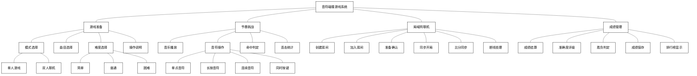
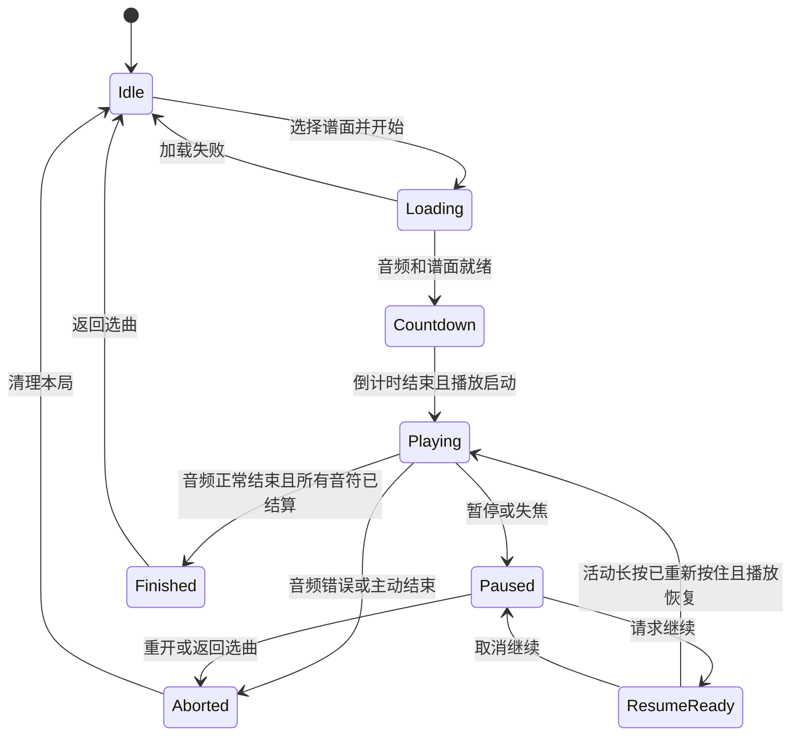
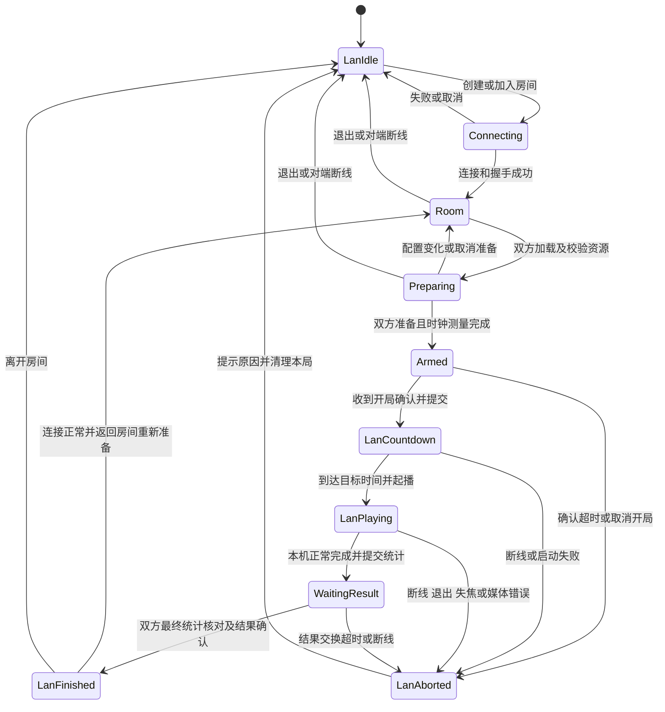

# 音符碰撞总体开发文档

版本：v0.3　更新日期：2026-11-16　项目代号：NoteCollision

本次规则修订：根据试玩反馈，Perfect / Great / Good 窗口放宽为 ±90 / ±150 / ±220ms，`rulesVersion` 设为 `"2"`；新增《小星星》三档谱面。按用户要求，首次读取已识别旧版成绩与设置时重置，不保留或迁移旧数据；新版产生的数据正常保存。文档版本 v0.3、应用版本 0.2.0 与判定规则版本2分别管理。当前实现和真实运行证据见[实现与验证记录](实现与验证记录.md)。

本文用于指导“音符碰撞”的需求确认、程序设计、编码、测试和后续报告整理。先确定软件要做什么，再确定数据、接口和实现顺序。需求分析与概要设计可分别整理为课程作业1、作业2；实际测试、截图和调试问题在开发过程中持续补充。

当前状态：单人玩法、音频、成绩与设置保存、局域网双人流程和可携带部署包均已有实现；本轮加入《小星星》并放宽判定窗口。下文保留需求、设计和测试计划，测试表中的“待执行”表示相应计划用例尚未在本文逐项填写结果，实际运行结论以[实现与验证记录](实现与验证记录.md)为准。两台实体电脑的网络、声画同步及实际键盘组合仍需实测。后续调整判定窗口、计分权重或评级阈值时，同步修改配置、规则版本、测试和本文。

## 1 编写依据与案例标注对照

### 1.1 资料依据

1. [音符碰撞题目](../../程序设计题/音符碰撞-曹骏禾-电子信息工程.doc)：确定必须完成的玩法和代码要求。文件中的姓名是出题人，不作为本项目开发者姓名。
2. [程序设计课程实用手册](../../5《程序设计》课程实用手册c.doc)：参照“需求分析范例”“概要设计”“写报告注意事项”“测试实例参考”“调试过程中的问题参考”。
3. [作业1作业2样本](../../程序设计题/作业1作业2样本.docx)：参照“功能框架图加文字说明”和“主要存储结构加函数概要”的组织方式。
4. [课程设计要求与优秀作品讲解转写稿](../../老师要求的录音/课程设计要求与优秀作品_自动转写参考稿.txt)及[学生管理系统开发讲解转写稿](../../老师要求的录音/学生管理系统开发讲解_自动转写参考稿.txt)：辅助理解先设计再编码、模块独立和测试论证的要求。转写稿未逐字校对，不将识别不清的数字作为评分标准。
5. [最新版功能框架图](../../程序设计题/音符碰撞_需求分析图_局域网联机版.png)及[局域网联机版需求说明](../../程序设计题/音符碰撞_需求分析文字说明_局域网联机版.md)：作为本次四大功能模块、双人流程及同分规则的更新依据。框架图中的“连续音符”对应本文原有的连锁节点玩法，两者为同一功能。

本次主要落实手册中的文字标注、作业样本和优秀作品讲解，不把其中其他题目的功能直接移植到本项目。

### 1.2 标注怎样落实到开发中

| 案例或课程标注 | 本项目的落实方式 | 对应章节 |
| --- | --- | --- |
| 需求分析先回答系统做什么 | 功能编号、输入输出、基本功能与选做功能分开 | 第2章 |
| 功能框架图配文字说明 | 先画功能分解，再解释页面与模块职责 | 第3章 |
| 概要设计列存储结构和函数概要 | 定义音符、谱面、统计、成绩，再列操作接口 | 第4章、第5章 |
| 函数独立且层次清楚 | 界面、时钟、判定、计分、音频、文件读写分开 | 第4章 |
| 注意数据限制 | 读取时检查类型、时间、轨道、分组和资源路径 | 第5章、第6章 |
| 测试围绕功能论证，不能只堆操作截图 | 按初始状态、操作、预期结果、证据和结论组织 | 第8章 |
| 调试说明现象、原因、修改并配图 | 保留真实问题记录和回归验证记录 | 第9章 |
| 图表规范且文字清楚 | 功能框架采用黑框白底、无箭头连线；流程和状态图使用方向箭头 | 第3章、第6章 |

整理课程最终报告时，按老师实际提供的报告模板转换为 Word：图与图题同页、统一编号和居中；选取约三个有深度的功能测试展开。开发期测试清单仍覆盖全部基本需求。

## 2 需求分析

### 2.1 项目目标与基本玩法

开发一个 Windows 桌面四轨下落式音乐游戏。玩家先选择单人游戏或双人局域网联机，再选择歌曲和难度；音符随音乐时间向判定线移动，使用 D、F、J、K 对应四条轨道，完成单点、长按、连锁和同时按键。程序按照击打时间误差计算判定、分数、准确率、连击和最终评级，并把有效完整成绩保存到按模式分开的本地排行榜。双人模式由一台电脑创建房间，另一台电脑通过局域网地址加入。

操作闭环：进入主菜单 → 选择模式 → 选择曲目及难度 → 单人直接加载，或双人创建/加入房间并准备 → 同步开局 → 演奏 → 单人直接结算，双人等待双方结果后结算 → 保存成绩 → 查看对应排行榜或重新开始。

当前交付曲目为原创合成的《霓虹脉冲》和采用公版曲调重新合成录音的《小星星》，每首均提供 Easy、Normal、Hard 三份独立谱面。初次游玩建议选择《小星星》Easy。曲目数量可以后续增加；四类音符和三档难度属于基本版要求。

### 2.2 基本功能

| 编号 | 功能 | 输入与处理 | 输出和验收要点 |
| --- | --- | --- | --- |
| FR01 | 主菜单及页面导航 | 选择单人/双人模式、排行榜、设置、帮助、退出 | 页面切换正确，返回与退出作用明确 |
| FR02 | 选曲及三档难度 | 选择歌曲和 Easy、Normal、Hard | 每首交付歌曲的三档谱面都可加载，密度、排列复杂度或接近速度有区别 |
| FR03 | 音乐与音符运行 | 音频文件、谱面和统一音乐时钟 | 音符按绝对时间移动，绘制延迟不改变判定规则 |
| FR04 | 单点音符 | 对应轨道一次有效按下 | 在判定窗口内结算一次，空按与重复键不重复得分 |
| FR05 | 长按音符 | 在头部窗口按下，保持至尾部 | 正常保持成功；头部漏击或提前松开失败；整条只结算一次 |
| FR06 | 连锁音符 | 按顺序快速击打多个节点 | 每个节点分别判定，中间漏击不禁止后续节点 |
| FR07 | 同时按键 | 对同一目标时间的多个轨道分别按下 | 支持双押和三押，各轨道独立判定，漏掉的键分别记 Miss |
| FR08 | 分数及准确度 | 汇总最终判定结果 | 统计与音符总数一致，分数和准确率采用同一组权重 |
| FR09 | Combo 及最终评级 | 成功、Miss 和最大连击 | 成功加连击，Miss 清零；显示最大连击及 S/A/B/C/D 评级 |
| FR10 | 排行榜与持久保存 | 昵称、模式、完整成绩、谱面标识 | 按模式、谱面及难度分榜，同分并列，重新打开后记录仍在 |
| FR11 | 单人暂停恢复和重新开始 | 单人模式下 Esc、暂停按钮、失焦、重新开始 | 暂停冻结游戏，恢复不导致批量 Miss，重开清空本局数据；联机不使用暂停流程 |
| FR12 | 设置、帮助和异常提示 | 音量、校准偏移、操作说明 | 设置可保存；缺文件、坏谱面、保存失败均有明确提示 |
| FR13 | 创建局域网房间 | 房主创建 TCP 房间并显示本机局域网 IPv4 和端口 | 最多允许一名客人加入；端口占用和房间已满有提示 |
| FR14 | 加入局域网房间 | 输入房主 IPv4 和端口并连接 | 错误地址、连接失败和协议不匹配可返回或重试 |
| FR15 | 联机准备与资源校验 | 房主选择曲目/难度，双方加载音频和谱面 | 音频 SHA-256、谱面 hash、难度、规则版本和音符总数一致后才能准备；配置变化清空准备状态 |
| FR16 | 联机同步开局与比分 | 双方准备后协商目标开局时间并交换比分快照 | 双方按映射的共同目标时间请求起播，实际偏差须双机实测；约每100ms更新对手累计比分；网络延迟不改变本地判定 |
| FR17 | 联机结算与胜负 | 双方分别完成并交换完整统计 | 仅比较最终分数，分数相同为平局；结果确认后才能保存正式成绩 |
| FR18 | 断线和退出处理 | 房间、倒计时、演奏或等待结算阶段发生断线/退出 | 提示并中止本局；未完成联机对局不保存、不进入正式排行榜 |

FR01、FR11、FR12 是为完成操作闭环补充的支撑功能。题目直接规定的主要玩法保留在 FR02—FR10；FR13—FR18 按最新版框架图补充局域网联机要求。

### 2.3 选做与后续扩展

| 编号 | 功能 | 安排 |
| --- | --- | --- |
| EX01 | 按判定等级播放不同点击反馈音效 | 对应原题选做要求，基本版稳定后加入 |
| EX02 | 自定义键位和更细的音画校准 | 默认键位与基本校准验证后加入 |
| EX03 | 更多歌曲、皮肤和视觉效果 | 保持谱面格式及核心判定接口稳定后加入 |
| EX04 | 练习模式或自动演示 | 成绩与正式模式隔离，不能进入正式排行榜 |

本轮基本版包含本地单人模式和两台电脑之间的局域网双人模式。联机使用手动输入局域网 IPv4 和端口，不包含账号系统、云服务器、在线跨局排行、自动发现房间、主机迁移、断线重连或实时自动生成谱面。

### 2.4 输入输出及质量要求

- 输入：键盘按下和松开事件、菜单操作、歌曲与谱面 JSON、音频文件、昵称、设置、房主地址及经过校验的网络消息。
- 游戏中输出：音符位置、判定反馈、当前分数、Combo 和音乐进度；联机另显示对手比分快照及连接状态。
- 结算输出：总分、准确率、四类判定数量、最大连击、评级、是否成功保存；联机另显示双方最终成绩、胜负/平局及结果确认状态。
- 文件输出：有效完整成绩、用户设置和必要的错误日志。
- 正确性：每个判定单元最终且仅最终结算一次；总判定数与谱面总数一致。
- 健壮性：空谱面和非法数据拒绝开始；缺少资源或保存失败时不假报成功。
- 可维护性：核心判定可脱离窗口运行；界面不能自行修改分数和音符状态。
- 显示目标：以约 60Hz 更新画面，但不能依赖固定帧率累计游戏时间；实际性能待测。
- 联机边界：最多两人；本机输入和判定不等待网络；同步精度须经双机实测，不能把同一目标起播时刻等同于声卡采样级同步。
- 注释要求：按照题目要求，变量说明用途，方法说明功能、参数与返回值，关键逻辑解释原因和规则。

## 3 总体设计

### 3.1 系统功能框架



图1 系统功能框架

游戏准备模块负责模式、曲目、难度和操作说明；节奏挑战模块负责音乐、音符、判定和连击；局域网联机模块负责房间、准备、同步开局、比分及断线；成绩管理模块负责结算、评级、胜负、保存和排行榜。功能图描述“系统能做什么”，下文的模块划分描述“由哪些代码承担”。

### 3.2 页面及导航

| 页面 | 主要内容 | 离开方式 |
| --- | --- | --- |
| 主菜单 | 开始、排行榜、设置、帮助、退出 | 进入对应页面；退出关闭程序 |
| 游戏准备页 | 模式、曲目、三档难度、谱面信息、操作说明 | 单人开始加载；双人进入创建房间或加入房间 |
| 创建房间页 | 本机局域网 IPv4、端口、房间状态、等待客人 | 客人加入后进入准备页；取消返回游戏准备 |
| 加入房间页 | 房主 IPv4、端口、连接状态、重试 | 连接成功进入准备页；失败可重试或返回 |
| 联机准备页 | 双方昵称、连接状态、资源校验、准备按钮 | 双方准备且资源一致后进入倒计时；修改配置需重新准备 |
| 游戏页 | 四轨、判定线、音符、分数、Combo；单人有暂停按钮，联机显示对手分数 | 单人完成后结算或暂停；联机完成后等待双方结果，退出则中止本局 |
| 单人结算页 | 分数、准确率、评级、判定数、最大连击、保存状态 | 重试同谱面、返回选曲、查看单人排行榜 |
| 联机结算页 | 双方最终分数、准确率、评级、胜负/平局、结果确认、保存状态 | 双方结果确认后保存；中止局只能返回 |
| 排行榜页 | 模式、曲目及难度筛选、排序后的有效成绩 | 单人和双人分榜；返回来源页面 |
| 设置及帮助页 | 音量、输入偏移、四类音符说明和操作说明 | 保存后返回，或取消本次修改 |

使用 `QMainWindow + QStackedWidget` 管理主页面，暂停菜单使用覆盖层或对话框。游戏绘制区使用自定义 `QWidget` 和 `QPainter`。首版不为每个音符创建独立按钮或独立线程。

### 3.3 游戏状态

单人模式沿用暂停和恢复状态：



图2 单人游戏状态转换

正常结算需要同时满足“媒体正常结束”和“全部音符已经结算”。最后一个音符后仍保留漏击窗口；媒体提前结束且尚有未到达的音符时，视为谱面或媒体异常。中途结束、音频错误和拖动进度产生的局不能提交正式排行。

倒计时、暂停和恢复准备阶段不推进谱面。重开先清理旧局，再从加载和倒计时流程开始，不能复用旧的连击、按键状态和保存标记。

联机模式由 `LanSessionService` 管理房间和对局状态；本机引擎完成后进入等待结果，不立即保存成绩。



图3 局域网房间与对局状态转换

联机不进入 Paused 或 ResumeReady。对局中止后清空准备及开局计划，不能以最后一次实时比分判定胜负；重新进入对局须重新准备并生成新的 `matchId`。

## 4 概要设计

### 4.1 技术方案及模块职责

计划使用 C++17、Qt Widgets、Qt Multimedia 和 Qt Network，构建采用 CMake 与 Ninja。当前已配置 Qt 6.8.3、MinGW GCC 13.1、GDB 11.2、CMake 3.31.10 和 Ninja 1.12.1；使用 VS Code 的“程序设计”配置文件。SDK 位于 `D:\Qt\6.8.3\mingw_64`，编译器位于 `D:\Qt\Tools\mingw1310_64`，包含 Widgets Designer、Multimedia 和 Network 组件；具体配置及环境验证记录见[VS Code Qt配置说明](../../VSCode-Qt配置说明.md)。现有窗口、音频及调试验证不等同于联机功能验证。

项目 CMake 已声明查找 Core、Widgets、Multimedia、Network 并链接对应 Qt6 目标；后续模块继续使用同一 SDK 和工具链。联机设计采用 `QTcpServer + QTcpSocket` 的异步信号槽，不在游戏更新过程中等待阻塞网络调用；网络组件已安装不代表完整联机已验收。

| 模块 | 主要职责 | 输入 | 输出 |
| --- | --- | --- | --- |
| AppController | 页面切换、本局生命周期、模块连接 | 用户操作、引擎事件 | 页面和游戏状态变化 |
| SongRepository | 曲目索引、谱面读取和完整性检查 | JSON、资源目录 | SongInfo、Chart 或带原因的错误 |
| GameEngine | 推进音符状态、输入分派、自动 Miss | 谱面、时间、按键 | 最终判定事件、只读游戏快照 |
| SongClock | 提供全局一致的音乐时间 | 播放、暂停、恢复状态 | 单调的谱面时间，单位毫秒 |
| AudioService | 背景音乐播放、暂停、结束及错误通知 | 音频路径和音量 | 播放状态，供时钟建立锚点 |
| ScoreService | 计分、准确率、Combo、评级 | 最终判定事件、固定总数 | PlayStats、最终结算结果 |
| GameWidget | 根据快照绘制并接收键盘事件 | 只读快照、用户输入 | 绘制结果和输入通知 |
| RecordRepository | 成绩加载、去重、保存、分榜和排序 | PlayRecord、筛选条件 | 排行列表或保存错误 |
| SettingsRepository | 设置加载、验证和保存 | 音量、输入偏移等 | AppSettings 或默认设置 |
| LanSessionService | 创建/加入房间、权限、准备、开局、比分、结算和中止 | 房间配置、网络事件、本机统计 | 房间状态、只读对手快照、已确认结果 |
| ProtocolCodec | TCP 帧编码、缓冲及半包/粘包解析 | 字节流及消息对象 | 通过格式校验的消息或协议错误 |
| ClockSynchronizer | 开局前往返采样及单调时钟偏移估计 | 时间戳和往返测量 | 客人时钟到房主时钟的映射及测量质量 |

`GameEngine` 不直接操作窗口或写文件；`GameWidget` 不直接增加分数；音频、设置和排行榜各自管理资源。模块之间使用明确的方法调用或 Qt 信号槽，避免相互包含所有头文件。

### 4.2 拟定项目文件组织

以下目录是当前代码布局和后续待补充目录；界面、音频、资源及部分联机实现仍按此结构继续补齐。

```text
code/
├─ CMakeLists.txt
├─ CMakePresets.json
├─ docs/
│  └─ 音符碰撞总体开发文档.md
├─ src/
│  ├─ main.cpp
│  ├─ app/             AppController
│  ├─ model/           音符 谱面 状态 成绩和配置结构
│  ├─ core/            GameEngine SongClock ScoreService
│  ├─ audio/           AudioService
│  ├─ network/         LanSessionService ProtocolCodec ClockSynchronizer
│  ├─ storage/         SongRepository RecordRepository SettingsRepository
│  └─ ui/              主窗口 页面 GameWidget 和 ui 文件
├─ assets/
│  ├─ songs/           曲目索引 音频和三档谱面
│  └─ ui/              图标和样式资源
└─ tests/
   ├─ data/            小型确定性谱面及异常文件
   ├─ core/            判定 计分 排序和文件测试
   └─ network/         协议分帧 房间状态 时钟及联机结果测试
```

编译输出放到独立的 `build` 目录。课程最终提交时，按老师要求整理源文件、必要资源、使用帮助和报告，清除自动生成的构建文件。

### 4.3 主要存储结构

谱面定义在加载后保持不变，运行状态单独保存。这样重开只需重新初始化运行状态，也便于用同一份谱面重复测试。

```cpp
enum class NoteType { Tap, Hold, ChainStep }; // 三种基础对象；同时按键由 chordId 分组表达
enum class NoteState { Pending, Holding, Hit, Miss }; // 音符运行状态
enum class Judgement { Perfect, Great, Good, Miss }; // 最终判定等级

struct NoteDefinition {
    int id;                  // 谱面内唯一音符编号
    NoteType type;           // 单点、长按或连锁节点
    int lane;                // 轨道编号 0 至 3，对应 D F J K
    qint64 hitTimeMs;        // 相对音频零点的目标击打时间
    qint64 endTimeMs;        // 长按尾部时间；其他音符等于 hitTimeMs
    int chainId;             // 连锁组编号；非连锁为 -1
    int chordId;             // 同时按键组编号；非同时按键为 -1
};

struct NoteRuntime {
    NoteState state;         // 当前状态，初始化为 Pending
    Judgement headGrade;    // 长按头部命中等级，Holding 时暂存
    bool finalized;         // 是否已经发出最终判定，防止重复结算
};
```

同时按键采用相同目标时间、不同轨道的多个音符，每个成员独立结算，不额外为整个组再加分。首版谱面仅把单点组成双押或三押；长按与连锁不混入同一个同时键组，以控制编辑和验收复杂度。

| 结构 | 关键字段及含义 | 生命周期与约束 |
| --- | --- | --- |
| SongInfo | id、title、artist、audioPath、difficultyCharts | 来自曲目索引；三档难度映射到对应谱面 |
| Chart | id、version、difficulty、audioDurationMs、approachMs、notes、chartHash | 单局开始前加载；notes 使用 `std::vector`，按时间和轨道排序 |
| JudgeConfig | perfectMs、greatMs、goodMs、rulesVersion | 全局规则；当前为90/150/220ms、rulesVersion="2"，三难度使用相同判定窗口 |
| GameSession | sessionId、mode、matchId、playerId、state、chart、runtime、laneDown、activeHolds | 每局新建；单人无 matchId；`laneDown` 为四元素布尔数组 |
| PlayStats | perfect、great、good、miss、earnedUnits、combo、maxCombo、finalizedCount | 只由最终判定更新；计数初始化为零 |
| PlayRecord | sessionId、mode、matchId、playerId、opponentName、opponentScore、resultId、winResult、playerName、songId、chartId、chartVersion、chartHash、difficulty、rulesVersion、score、统计、评级、finishedAtUtc | 单人完整结束或联机结果确认后生成；winResult 为胜/负/平，单人不适用 |
| RoomConfig | roomId、configRevision、songId、chartId、chartVersion、difficulty、chartHash、audioHash、rulesVersion、noteCount | 房主修改配置即递增版本，取消双方准备及旧开局计划 |
| LanSession | role、roomConfig、localPlayerId、peerPlayerId、readyFlags、matchId、startHostMs、peerStats、lastSeq、resultState | 网络生命周期数据，与本机音符运行状态分开；每局重置 |
| AppSettings | musicVolume、effectVolume、inputOffsetMs、schemaVersion | 跨运行保存；音量范围 0 至 100，偏移范围 -200 至 200ms |

时间使用 `qint64` 的毫秒值；分数中间计算使用 64 位整数。动态数据通过标准容器管理，避免固定数组越界和无所有权说明的裸指针。

### 4.4 函数及接口概要

下列接口确定职责和输入输出，具体类声明在编码时补齐完整注释、错误类型和必要的只读限定。

| 接口 | 输入 | 输出或行为 |
| --- | --- | --- |
| `SongRepository::loadIndex()` | 曲目索引路径 | 曲目列表或加载错误 |
| `SongRepository::loadChart()` | 谱面路径 | 完整检查后的 Chart 或错误列表 |
| `validateChart()` | Chart、资源目录 | 检查时间、轨道、分组、资源和总量限制 |
| `SongClock::start()` | 音频开始位置及单调时钟锚点 | 开始提供音乐时间 |
| `SongClock::nowMs()` | 无 | 当前谱面时间，暂停时保持不变 |
| `SongClock::pause()` / `resume()` | 播放状态及保存的暂停位置 | 冻结或从保存位置继续 |
| `GameEngine::startSession()` | Chart、JudgeConfig | 新建本局状态和唯一 sessionId |
| `GameEngine::advanceTo()` | 当前音乐时间 | 完成长按、处理超时漏击和结束条件 |
| `GameEngine::handleKeyPress()` | 轨道、当前音乐时间 | 一次有效按下最多触发一个头部 |
| `GameEngine::handleKeyRelease()` | 轨道、当前音乐时间 | 更新键态，检查该轨道活动长按 |
| `GameEngine::finalizeNote()` | 音符编号、最终等级 | 幂等结算，已经 finalized 时不再发事件 |
| `ScoreService::applyJudgement()` | 唯一最终判定事件 | 更新分数、计数和 Combo |
| `ScoreService::buildResult()` | 全部结算统计、固定音符总数 | 最终分数、准确率及评级 |
| `RecordRepository::saveOnce()` | 完整 PlayRecord | 单人按 sessionId，联机按 matchId + playerId 去重后原子保存 |
| `RecordRepository::queryRanking()` | 模式、谱面、难度和规则版本 | 分数降序、同分并列的榜单 |
| `SettingsRepository::load()` / `save()` | 设置路径及配置 | 有效设置、默认值或保存错误 |
| `LanSessionService::createRoom()` / `joinRoom()` | 端口，或房主 IPv4 与端口 | 创建监听或异步连接，报告状态及错误 |
| `LanSessionService::setRoomConfig()` / `setReady()` | 曲目配置，或对应配置版本的准备状态 | 房主更新配置、双方重新校验及准备 |
| `ClockSynchronizer::sample()` | 本地与房主往返时间戳 | 估计偏移、RTT 和映射后的起播时间 |
| `LanSessionService::requestStart()` | 当前房间配置和双方准备状态 | 房主协调 START_ARM / ARMED / START_COMMIT |
| `ProtocolCodec::feed()` / `encode()` | 新收到的字节，或待发送消息 | 解析零到多帧，或输出带长度的字节串 |
| `LanSessionService::publishStats()` / `submitFinish()` | 当前累计统计，或完整最终统计 | 同步比分，或开始最终结果核对 |
| `LanSessionService::abortMatch()` | 中止原因 | 通知对端、停止播放、清理本局，禁止正式保存 |

例如，`handleKeyPress` 只处理一次按下的游戏含义，不承担绘制、播放音乐或保存成绩。头文件声明接口，源文件实现逻辑，主程序仅组装模块和启动应用。

## 5 数据文件与校验设计

### 5.1 文件分工

| 数据 | 格式与位置 | 读写规则 |
| --- | --- | --- |
| 曲目索引 | `assets/songs/index.json` | 列出曲目和三档谱面路径，运行时读取 |
| 谱面 | 各曲目目录下 `easy.json`、`normal.json`、`hard.json` | UTF-8 JSON，可人工检查；单局内只读 |
| 音乐 | 各曲目目录下音频文件 | 首版演示优先使用 WAV；实际时长必须覆盖最后音符和漏击窗口 |
| 成绩 | `QStandardPaths::AppDataLocation` 下 `records.json` | 加载后检查；通过 QSaveFile 写入并提交 |
| 设置 | 同一用户数据目录下 `settings.json` | 首次启动生成默认值；修改后验证并保存 |

可写用户数据不放在源码目录或当前工作目录。程序资源从明确的应用资源目录解析，不能假定用户总在 VS Code 中启动程序。

### 5.2 谱面格式示例

下面是用于说明格式和确定性测试的六音符谱面，其中包括四类表现形式；实际游玩使用 `assets/songs` 下的《霓虹脉冲》和《小星星》谱面。

```json
{
  "schemaVersion": 1,
  "chartId": "demo-normal",
  "chartVersion": 1,
  "songId": "demo",
  "difficulty": "Normal",
  "audioDurationMs": 10000,
  "approachMs": 1800,
  "notes": [
    {"id": 1, "type": "tap",   "lane": 0, "timeMs": 3000},
    {"id": 2, "type": "hold",  "lane": 1, "timeMs": 4000, "endMs": 5000},
    {"id": 3, "type": "tap",   "lane": 2, "timeMs": 5500, "chordId": 1},
    {"id": 4, "type": "tap",   "lane": 3, "timeMs": 5500, "chordId": 1},
    {"id": 5, "type": "chain", "lane": 0, "timeMs": 6000, "chainId": 1},
    {"id": 6, "type": "chain", "lane": 1, "timeMs": 6300, "chainId": 1}
  ]
}
```

省略的可选分组编号读取为 -1；非长按音符的 `endTimeMs` 设为 `hitTimeMs`。`chartHash` 在校验成功后对规范化谱面内容计算，用于分开不同版本的成绩。

### 5.3 加载校验

加载时先检查 JSON 和字段类型，再生成临时 Chart，全部通过后才交给引擎。

1. `schemaVersion` 必须受支持；歌曲、谱面标识和难度不能为空。
2. 音符编号唯一，轨道为 0—3，时间为非负整数；首个目标时间不早于 `approachMs`。
3. 谱面不为空，首版音符数量上限暂设为 20000；超限给出原因，不静默截断。
4. 长按满足 `endMs > timeMs`，最后尾部或目标时间加 220ms 不超过音频时长。
5. 同轨道不能存在相同目标时间；同轨两个头部至少间隔 200ms。长按期间不得安排同轨新头部，尾部之后至少留 200ms 再安排新头部。
6. 一个同时键组包含两个或三个单点、相同目标时间、互不重复的轨道；组内每个成员仍是独立判定单元。
7. 一个连锁组至少两个节点，时间严格递增；首版节点间隔不小于 200ms。
8. 索引、谱面、音频对应同一歌曲；路径解析后的文件位于资源根目录内且可读取。
9. 三档难度都指向有效谱面；难度不能只改显示名称而沿用完全相同的内容和参数。

接近时间由各谱面的 `approachMs` 决定，当前曲目配置如下。谱面密度和排列复杂度通过独立编辑调整，两首曲目的三档难度均使用相同的90/150/220ms判定窗口。

| 曲目 | 音频时长 / BPM | Easy / Normal / Hard 判定单元数 | Easy / Normal / Hard 接近时间 |
| --- | --- | --- | --- |
| 霓虹脉冲 | 36秒 / 120 | 68 / 84 / 136 | 2200 / 1800 / 1400ms |
| 小星星 | 约33.8秒 / 100 | 43 / 57 / 66 | 2400 / 2000 / 1700ms |

音频均为44.1kHz、16-bit、立体声 PCM WAV；三档均覆盖四类音符。《小星星》通过较慢速度、更长接近时间和较少音符提供入门选择。来源、生成方式与资源详情见[霓虹脉冲说明](../assets/songs/neon-pulse/README.md)和[小星星说明](../assets/songs/twinkle-star/README.md)。

### 5.4 成绩保存与排行榜

- 只提交完整正常结束且统计自洽的正式成绩：`perfect + great + good + miss == N`。联机还要求本端完成第6.7节的最终结果确认；只收到实时比分或本方 FINISH 不能保存正式成绩。
- `sessionId` 是单人本局唯一标识；联机使用 `matchId + playerId` 作为幂等键。重复点击保存或重复收到结算信号时，只能存在一条同局记录。
- 分榜键为 `mode + songId + chartId + chartVersion + chartHash + difficulty + rulesVersion`。不同模式、难度、谱面和计分规则不混排；联机记录另保存对手昵称和胜负结果。
- 保存全部有效历史记录；榜单展示同一分榜键下每个昵称的最佳一条，最多显示前20名。昵称仅为本地显示名，不提供账号认证。
- 昵称去除首尾空白后长度为1—16个字符；空白昵称不允许保存。
- 名次只由总分降序决定，总分相同即并列；使用竞赛名次，例如第1、1、3名。同分项按完成时间升序、记录唯一标识字典序稳定显示，最大连击和准确率不打破并列。联机胜负也只比较最终分数，同分为平局，不使用完成时间或 Combo 判胜。
- 联机每端保存本方个人成绩，附对手昵称、双方最终分数摘要和胜负；对手成绩可在对局详情中展示，不额外复制成该电脑的本地参赛记录。中止局及结果未确认的本端不写入正式成绩文件。
- 新版成绩文件使用 `schemaVersion` 3，设置使用 `schemaVersion` 2。根据用户要求，首次读取已识别的旧成绩版本1/2与旧设置版本1时，通过原子写入分别重置为空成绩和默认设置，不保留或迁移旧数据；新格式的数据此后正常保存。重置写入失败时保留原文件并提示；未知未来版本与当前版本损坏文件仍提示并保护。
- 先完成内存中的校验与合并，再使用 QSaveFile 写临时文件并 `commit()`。失败时保留原文件，结算页显示“保存失败”和具体原因。
- 损坏成绩文件先保留原件或复制为带时间的异常备份，再提示用户处理；不能静默用空榜覆盖原文件。异常处理前仍可展示本次结算，但不宣称已保存。

## 6 详细设计与核心规则

### 6.1 统一音乐时钟

所有绘制、按键、自动 Miss 和长按完成检查必须调用同一个 `SongClock`。`QTimer` 仅触发更新和重绘，不用“每帧16ms”累加时间。

首版采用 `QMediaPlayer + QElapsedTimer`：等待媒体就绪且播放器实际进入播放态后建立音频位置与单调时钟锚点，通过高精度经过时间得到局内音乐时间。

```text
musicTimeMs = anchorMusicMs + monotonicElapsedMs
judgeTimeMs = musicTimeMs + inputOffsetMs
```

`inputOffsetMs` 只用于头部击打时间校准，正值把输入视为更晚，负值把输入视为更早。绘制、超时检查和长按保持时长使用未加输入偏移的音乐时间；空闲菜单设置偏移，进行中的本局不允许更改。

`positionChanged` 通知只用于状态核对和较大偏差诊断，不在每次通知时直接重置时钟。单人暂停保存精确的局内位置，恢复时从该位置重建锚点；重开必须从媒体零点重新建立时钟。媒体缓冲中断或异常偏差时，单人进入暂停/错误流程，联机中止本局，不突然跳过一段时间继续判定。联机目标时间只协调开局；起播后每端仍以本机音频锚点判定，不能根据对手进度包拉动本机音乐追赶。

90ms 等窗口是当前设计规则，尚不是音频设备实测精度。开发时记录声画与输入偏移；如课程验收需要更严格的同步，再将音频内部替换为预解码 PCM WAV 与 `QAudioSink::processedUSecs()`，保持 SongClock 对外接口不变。

### 6.2 音符位置与绘制

设起点为 `spawnY`，判定线为 `judgeY`，接近时间为 `approachMs`：

```text
progress = 1 - (hitTimeMs - musicTimeMs) / approachMs
y = spawnY + progress * (judgeY - spawnY)
```

除法采用浮点计算，仅用于画面。判定直接比较时间，不比较音符图像是否相交。只绘制处于可见时间范围且尚未结束的音符，避免逐帧创建和销毁大量 Qt 对象。

长按头部和尾部分别按各自目标时间映射位置，保持期间显示轨道高亮。分辨率变化只改变坐标，不改变谱面时间和判定阈值。

### 6.3 单点判定与输入顺序

先在事件处理入口读取一次音乐时间，再将引擎推进到该时刻，最后处理此次按键；不混用原点不同的事件时间戳。按下与松开均忽略 `isAutoRepeat()`，已经处于按下状态的轨道再次收到按下时不重复触发。

头部误差 `deltaMs = judgeTimeMs - hitTimeMs`，判定规则版本 `rulesVersion="2"` 的窗口如下。该规则同时用于单人、联机及全部难度；联机两端规则版本必须一致。

| 条件 | 判定 | 权重单位 |
| --- | --- | --- |
| `abs(deltaMs) <= 90` | Perfect | 1000 |
| `90 < abs(deltaMs) <= 150` | Great | 700 |
| `150 < abs(deltaMs) <= 220` | Good | 400 |
| 超出窗口后仍未命中 | Miss | 0 |

同轨候选选择规则：先处理已经超时的音符，再从该轨尚未处理且在窗口内的头部中，选择目标时间最早的一枚。一次有效按下最多命中一枚；无候选时为空按，不加分、不改 Combo。提前超过窗口的输入不会提前消费音符。

超时条件与偏移使用同一条时间基准：`musicTimeMs > hitTimeMs + 220 - inputOffsetMs` 时，未命中的头部才自动 Miss。这保证偏移配置后，最晚仍可命中的输入不会先被超时逻辑吃掉。边界刚好220ms仍可命中。

### 6.4 长按 连锁与同时按键

**长按**：头部命中后从 Pending 进入 Holding，保存头部等级，此时不增加分数或 Combo。音乐到达 `endTimeMs` 且仍保持时，按头部等级最终结算一次；首版采用严格尾部规则，提前松开即 Miss。

松开事件必须先执行 `advanceTo(now)`：若 `now >= endTimeMs`，先完成长按，再更新松开状态；若 `now < endTimeMs` 且正在正常演奏，结算一次 Miss。头部未命中的长按超时后直接 Miss，尾部不能再产生第二次结算。

**连锁**：每个 ChainStep 按单点规则分别计算等级、分数和 Combo。中间节点 Miss 只影响当时的连击，后续节点仍可击打。连接线和整组完成提示只影响显示，不产生额外组分。

**同时按键**：同目标时间的不同轨道成员独立接收事件，不要求它们在同一毫秒到达。双押按中两键记两个判定，三押记三个；只按中一键时，已命中成员保留成绩，其余成员超时后分别 Miss。按住一键产生的自动重复不能代替另一个轨道。

任何成功或失败都通过 `finalizeNote()`，先检查 finalized，再设置终态和发出唯一事件。UI 动画结束、定时器重入和重复信号不能再次结算。

### 6.5 计分 准确率 Combo 与评级

固定判定总数：

```text
N = 单点数量 + 长按数量 + 连锁节点数量 + 同时按键成员数量
```

这里同时按键成员本身是单点对象，实际统计时遍历每条 NoteDefinition 仅计一次；不能把成员既计入单点又再次相加。等价实现为 `N = chart.notes.size()`。

设 Perfect、Great、Good、Miss 数量分别为 P、G、H、M：

```text
P + G + H + M = N
earnedUnits = 1000*P + 700*G + 400*H
accuracy = earnedUnits / (1000*N)
score = floor(1000000 * earnedUnits / (1000*N))
```

准确率以百分比显示两位小数，分数取0—1000000整数，不能先把准确率显示值四舍五入再算分。空谱面在加载阶段拒绝，避免除以零。局内以完整谱面的 N 计算当前累计分数；未结算的长按尚未得分。

每个最终 Perfect、Great、Good 使 Combo 加一，Miss 清零，每次更新最大连击。长按在尾部完成时加一；同一时刻多个结算事件按目标时间、轨道和 id 的稳定顺序处理。最大连击指最终结算事件中的最长连续成功数，上限为 N。

| 条件，按顺序匹配 | 最终评级 |
| --- | --- |
| 准确率至少95%，且 `maxCombo / N >= 80%` | S |
| 未满足 S，准确率至少90% | A |
| 准确率至少80% | B |
| 准确率至少70% | C |
| 其他 | D |

另外独立显示 FC（M为0）和 AP（P为N）标记。准确率、评级、最大连击含义分别说明，不把“高准确率”直接显示为“全连”。当前规则不加连击倍率，避免难度不同和额外倍率破坏归一化含义。

### 6.6 暂停 恢复 重开及失焦

以下五项为单人规则：

1. 正常演奏时按 Esc 或失焦，暂停音乐和 SongClock，保存活动长按集合，进入 Paused。
2. 清空物理按键状态；暂停期间的按下和松开不触发得分、Miss 或长按早松。
3. 请求继续后进入 ResumeReady。仍有活动长按时，在冻结的时间线上提示重新按住对应轨道；全部按住才允许恢复。
4. 恢复准备中的按键只恢复物理状态，不作为新音符头。确认播放恢复后再重启时钟和引擎推进。
5. 重新开始或返回选曲时停止旧播放器，清除音符运行状态、按键、统计、旧信号连接和本局保存标记。使用新的 sessionId。

不得在暂停时直接把活动长按判为 Miss，也不得清空键态后在恢复首帧立即把所有长按判失败。返回选曲是中止本局，退出程序是关闭应用，两者都不保存未完成成绩为正式成绩。

双人模式隐藏暂停和单方重开按钮。演奏中按 Esc 作为退出本局请求，立即走中止流程；失焦同样中止并通知对方，清空按键和活动长按，不进入单人暂停状态。重新对战须双方返回房间后重新准备。

### 6.7 局域网联机设计

#### 6.7.1 房间、资源和职责

两台电脑在同一局域网中运行相同版本程序。一方使用 `QTcpServer` 创建房间并显示可用的本机局域网 IPv4 及端口，另一方手输地址并使用 `QTcpSocket` 加入。最多两人；多网卡时允许房主查看候选局域网地址，不把回环地址当作另一台电脑的连接地址。端口占用、拒绝连接、地址错误及连接超时均提示原因并允许重试。

房主负责曲目、难度、准备状态协调、开局计划和最终结果核对；客人只能修改本方准备、提交本方统计和退出。两端复用相同 `GameEngine`、`SongClock` 和 `ScoreService`，各自处理本地按键和判定。网络只同步房间、开局、比分快照及最终结果，不能用远程收到按键的时间决定本地击打等级。

双方本地必须持有相同音频和谱面，首版不传输歌曲文件。音频用 SHA-256，谱面用校验后的规范化内容 hash；规范化固定字段集合、音符排序、整数形式及 UTF-8 编码，排除空白和文件绝对路径。校验还包括难度、规则版本和音符总数。双方所有资源加载及媒体预加载成功后才允许准备。房主更改曲目或难度即递增 `configRevision`，清空双方准备和旧开局计划，重新校验。

#### 6.7.2 TCP 帧和消息约定

协议使用“四字节无符号大端长度 + UTF-8 JSON”，长度只计 JSON 正文字节。`ProtocolCodec` 保留接收缓冲，每次可能解析零到多帧，处理 TCP 半包和粘包。单帧上限暂定64 KiB；长度为零、超限、坏 JSON、字段类型不符或越权消息均拒绝并报告协议错误，不能无限累积缓冲。

公共字段为 `protocolVersion`、`type`、`roomId`、`matchId`、`seq`、`payload`。握手前尚未分配的标识允许为空，进入对局后必须匹配当前标识；配置相关消息带 `configRevision`。`seq` 由每个发送端在一条连接上递增，重连建立新会话，旧对局或旧配置消息不能沿用。

序号用于去除同一消息信封的重复；应用层重发请求或结果时使用新的 `seq`，保持相同 `matchId` 和 `resultId`，接收端返回已缓存的同一逻辑结果。不能因为去重而重复落盘，也不能把同一结果的新序号重发误认作新比赛。

| 消息 | 发送方及用途 |
| --- | --- |
| HELLO / ROOM_STATE | 客人握手；房主返回房间及 playerId |
| ROOM_CONFIG / READY | 房主广播配置；各自报告本版本资源已就绪及准备状态 |
| CLOCK_PING / CLOCK_PONG | 开局前测量双方单调时钟偏移及往返耗时 |
| START_ARM / ARMED / START_COMMIT | 房主提出计划、客人确认、房主提交开局 |
| STARTED | 双方报告实际请求/进入播放状态及相对目标偏差 |
| SCORE_SNAPSHOT | 双方发送本方累计统计，供对手显示 |
| FINISH | 双方提交本方完整最终统计 |
| MATCH_RESULT / RESULT_ACK / RESULT_CONFIRMED | 房主给出结果、客人核对回执、房主确认收到回执 |
| HEARTBEAT / ABORT | 检测连接存活；告知中止原因 |

接收时同时检查长度、字段、协议版本、房间/对局标识、配置版本、序号、当前状态及发送方权限。客人不能发送房主配置或开局提交，任一端不能提交对方的统计。用 `readyRead`、连接状态信号和定时器驱动，不在游戏循环调用阻塞等待。

#### 6.7.3 准备和同步开局

1. 客人发送 `HELLO(protocolVersion, nickname)`，房主校验人数及版本后分配 `playerId`，返回 `ROOM_STATE`。
2. 房主发送 `ROOM_CONFIG`，双方验证音频 SHA-256、谱面 hash、难度、`rulesVersion` 和 N，完成媒体预加载后发送绑定 `configRevision` 的 `READY`。房主自己的资源也必须就绪。
3. 进行五次时钟往返采样。设客人发送/接收为 t1/t4，房主接收/回复为 t2/t3，估计 `offset = ((t2-t1)+(t3-t4))/2`，`RTT = (t4-t1)-(t3-t2)`；采用有效采样中 RTT 最低的一次。时钟单位为毫秒且各端原点在本次会话保持固定，不能直接比较未经映射的 `QElapsedTimer` 或使用系统日历时间。
4. 房主生成新 `matchId`，选取约三秒后的 `startHostMs`，发送 `START_ARM(matchId, configRevision, startHostMs)`。客人的目标为 `startGuestMs = startHostMs - offset`；检查剩余时间、配置和资源后回复 `ARMED`。
5. 房主在截止前收到 `ARMED` 才发送 `START_COMMIT`。客人未收到提交不能起播；超时、计划过期、重复开始或配置变化时取消计划。双方在映射后的目标时刻请求播放，实际进入播放状态后建立本机 SongClock 锚点并发送 `STARTED`。
6. 任一端明显迟到、播放失败或未及时报告启动，整局中止。TCP 断网时无法保证两端原子同时启动；不能一端补播后把本局当作正常对局，也不能拉动正在演奏的音频追赶。

首版暂定开局提前量3000ms、ARMED 截止提前500ms、实际启动偏差绝对值上限150ms、启动状态等待1000ms（自目标时刻起计）。以上为待实测调整的参数；两台实机记录目标和实际起播偏差后确认验收范围，不把共同目标时间解释为两块声卡采样级同步。

#### 6.7.4 比分快照与本地判定

每约100ms发送一次 `SCORE_SNAPSHOT`，包含 `matchId`、`seq`、`musicTimeMs`、Perfect/Great/Good/Miss、`finalizedCount`、Combo、`maxCombo`。分数和准确率由同一公式重算；`P+G+Good+Miss == finalizedCount <= N`，累计计数、`finalizedCount` 和 `maxCombo` 不得倒退，Combo 可以因 Miss 归零。

对手界面只展示最近有效快照。旧对局、重复或倒退序号直接丢弃；未发送快照可以合并为最新状态，避免网络积压过期数据。对手的包晚到只影响显示新鲜度，不能重放远端按键、再次加分、阻塞本机判定或改变本机音乐时间。最终结果不能采用最后一份实时快照。

#### 6.7.5 最终成绩和确认

1. 本机正常完成后发送 `FINISH`，包含完整统计、最大连击、谱面/规则标识及本局 ID，进入等待对方结果。等待期间继续处理网络和心跳。
2. 房主收齐两份结果，检查非负整数计数、`P+G+Good+Miss=N`、Combo 范围、相同谱面和规则，重新计算分数、准确率和评级，生成带唯一 `resultId` 的 `MATCH_RESULT`。高分者胜，同分平局；不比较结束先后、准确率或最大连击来打破平局。
3. 客人按相同公式核对含两方统计的结果，通过后发送 `RESULT_ACK`；房主收到对应结果的回执后标记本端确认，发送 `RESULT_CONFIRMED`。客人收到确认后标记本端确认。重复消息返回相同结果，不再次生成记录。
4. 每端确认后按 `matchId + playerId` 保存本方记录，界面分别显示“结果已确认”和“保存成功/失败”。文件写入失败可以重试，不改变已经确定的胜负。

网络中断可能使最后确认只到达一端，首版不承诺两台电脑原子落盘。已确认的一端保留已确认结果；未收到最终确认的一端显示“结果未确认”，不自行推定胜负或入榜。日志保留 `matchId`、结果标识及确认阶段，不能因离开房间后的断线撤销已经确认的结果。

房主只能校验统计内部一致性，无法凭这些统计证明客人没有修改客户端；本方案不宣称反作弊能力。

#### 6.7.6 中止、超时和清理

- 房间阶段断线：清空双方准备及待提交计划，提示后回联机入口；重新进入须重新握手。演奏前的资源不一致只阻止准备，允许房主改配置或玩家退出。
- 已开始或正在开局的对局遇到主动退出、按 Esc、失焦、音频错误、房主关闭或连接中断，立即中止，尽力发送 `ABORT(reason)`。无连接时由对方的断线或超时检测结束，不能要求通知一定送达。
- 首版心跳间隔1000ms，连续5000ms没有有效消息视为连接失效；连接超时暂定5000ms、资源加载超时30000ms、本机结束后最终结果交换超时15000ms。参数须和完整曲目及慢设备实测一起检查。
- 中止后停止播放器、清空物理键态、长按状态、对手显示及旧开局回调；未确认结果不生成正式胜负，不保存正常完赛成绩，不自动判退出者负。
- 首版不做重连续局、主机迁移或单方重开；再战时清空旧统计并重新准备，生成新的 `matchId`。单人继续采用第6.6节暂停方案。

## 7 开发阶段与验收条件

先完成需求和概要设计，再逐步实现。下表使用阶段编号，不编造尚未确定的课表日期、成员姓名和贡献比例。

| 阶段 | 工作内容 | 阶段通过条件 | 当前状态 |
| --- | --- | --- | --- |
| P0 设计确认 | 完成本文、核对题目及最新版框架、确认单双人规则 | FR01—FR18都有模块、接口和验收项；待定规则已确认 | v0.2设计待审阅 |
| P1 基础工程 | CMake 工程、页面骨架、谱面加载与校验 | 能启动、切页、读取有效谱面，能拒绝非法数据 | 已有部分源码，待集成验收 |
| P2 纵向演示 | 一个难度的单点、时钟、音乐、计分及结算 | 能完成选曲到结算；单点窗口和重复键测试通过 | 已有部分核心源码，待集成验收 |
| P3 核心玩法齐全 | 长按、连锁、双押/三押及三档谱面 | 四类均有成功和失败路径；三难度可演奏 | 已有部分核心源码，待集成验收 |
| P4 单人使用闭环 | 暂停恢复、评级、设置、排行和保存 | 单人完整可用；统计自洽，重启恢复正确，保存失败有提示 | 待完成及验收 |
| P5 局域网联机 | Qt Network、协议、房间、资源校验、同步开局、比分和最终结果 | 两台电脑能完整对局；FR13—FR18、T15—T26通过，断线不生成正常成绩，单双人分榜 | 已有部分网络源码，待集成及双机验收 |
| P6 基本版验收 | 单人和双人回归、深入案例、截图、帮助和双机打包验证 | FR01—FR18均有真实测试证据；独立机器可运行，联机同步偏差有实测记录 | 待验收 |
| P7 选做完善 | 分级反馈音效及必要的美化 | 不破坏已通过的基本功能与正式成绩规则 | 基本版后安排 |

P2只是中间演示；P6通过后才标记“基本版完成”，不能把单人可运行当作本轮全部完成。每次修改先更新受影响的需求、接口和用例，再编码并回归相关功能。

联机需求与验证的对应关系如下；实际实现时补充源文件路径和证据位置。

| 需求 | 主要承担模块 | 验证用例 |
| --- | --- | --- |
| FR13—FR14 房间连接 | LanSessionService、ProtocolCodec | T15、T20 |
| FR15 准备校验 | SongRepository、LanSessionService | T16、T17 |
| FR16 开局及比分 | ClockSynchronizer、AudioService、SongClock、LanSessionService | T18—T20、T26 |
| FR17 胜负和保存 | ScoreService、LanSessionService、RecordRepository | T11、T21、T22、T25 |
| FR18 中止处理 | AppController、AudioService、LanSessionService | T23、T24 |

成员确定后在这里补充分工、个人负责文件和实际贡献百分比，并补录实际截止时间。当前两首曲目及资源来源已在第5.3节与各资源目录说明中记录。

## 8 测试计划

### 8.1 测试方式与基本清单

核心判定支持注入测试时间，使用小型确定性谱面验证边界；界面、真实键盘、音乐播放、单人暂停和保存另做集成测试。局域网功能先验证协议解析和状态转换，再使用同一局域网内的两台电脑进行完整对局；单机回环连接不能代替双机音乐、键盘与网络验证。预期输出来自本设计，实际输出必须由运行取得。

| 编号 | 场景 | 预期要点 | 状态 |
| --- | --- | --- | --- |
| T01 | 曲目及三档难度 | 所有交付谱面可加载且内容有区别 | 待执行 |
| T02 | 判定窗口边界 | ±90、±150、±220ms有且只有一个等级，超出后不能命中 | 待执行 |
| T03 | 输入偏移 | 正负偏移下，有效窗口与自动 Miss 边界一致 | 待执行 |
| T04 | 自动重复与空按 | 不重复消费音符、不重复计分 | 待执行 |
| T05 | 长按成功及早松 | 尾部只结算一次，早松和漏头各只产生一个 Miss | 待执行 |
| T06 | 连锁漏击 | 漏掉中间节点清零 Combo，后续节点仍能正常击打 | 待执行 |
| T07 | 双押及三押 | 各键独立判定，真实键盘能正确上报对应组合 | 待执行 |
| T08 | 分数与评级 | 全 Perfect为100万和100%，总计数为N，S条件含最大连击比例 | 待执行 |
| T09 | 单人暂停及失焦 | 单人模式下时间和判定冻结，活动长按可重新按住后恢复；联机行为另见T23 | 待执行 |
| T10 | 单人重开和返回 | 旧状态清空，未完成局不提交排行；联机再次对战另见T25 | 待执行 |
| T11 | 排序 分榜 去重 | 单人和联机、不同谱面及难度分别排行；同分并列，其他字段仅稳定展示顺序；同局记录只保存一次 | 待执行 |
| T12 | 重启读取与保存失败 | 重启数据一致，写失败保留旧文件，不假报保存成功 | 待执行 |
| T13 | 错误数据及缺资源 | 拒绝空谱面、越界轨道、重复id、坏分组和丢失音频 | 待执行 |
| T14 | 长时间运行及重复切换 | 无持续计时漂移，无重复连接造成的重复事件，资源能释放 | 待执行 |
| T15 | 创建和加入房间 | 两台电脑通过房主局域网地址及端口连接；错误地址、端口占用、连接超时有提示；第三人不能加入 | 待执行 |
| T16 | 联机资源和版本一致性 | 缺音频、同名不同谱面、音频校验值或规则版本不符均禁止准备，不能只比较显示名称 | 待执行 |
| T17 | 准备确认及配置变更 | 未全部准备不能开局；房主改曲或改难度后双方准备失效，旧配置的准备和开始消息无效 | 待执行 |
| T18 | 同步开局及启动失败 | 双方预加载、确认同一开局计划后按映射的目标时间启动；重复开始不生成两局；确认超时、迟到或音频失败使本局中止 | 待执行 |
| T19 | 比分同步与网络延迟 | 对手比分随有效快照更新；重复、旧局、倒退序号不覆盖当前状态；增加网络延迟不改变本地命中判定，不阻塞游戏 | 待执行 |
| T20 | 协议解析和非法消息 | 分段及连续接收多帧均正确；非法长度、超限帧、坏JSON、错误字段及越权消息被拒绝，不使程序崩溃 | 待执行 |
| T21 | 最终成绩交换和核对 | 本地结束后等待对方；双方统计完整且与本局匹配才生成正式结果，不能以最后一次实时比分代替；非法统计或等待超时不入榜 | 待执行 |
| T22 | 胜负及同分规则 | 高分者胜，最终分数相同即平局；最大连击或完成先后不同不能破坏平局，排行榜同分并列 | 待执行 |
| T23 | 联机退出及失焦 | 联机不进入暂停或恢复状态；按Esc退出、失焦均中止本局并通知对方，不自动判负，不保存正常完赛成绩 | 待执行 |
| T24 | 各阶段断线及房主关闭 | 分别在房间、倒计时、演奏和等待结果时断线；能取消旧计划或中止未确认对局，提示返回，不重连续局或自动判胜负 | 待执行 |
| T25 | 重复结果及再次对战 | 同一resultId重发不重复保存；最后确认丢失时已确认端保留结果，未确认端不入榜；再次对战重新准备并使用新对局标识，清除旧比分、键态、统计及信号连接 | 待执行 |
| T26 | 双机时钟和完整曲目验证 | 记录时钟估计、目标及实际起播偏差，完成整曲并检查声画同步与比分更新；实测偏差满足最终确认的同步目标 | 待执行 |

### 8.2 深入案例一 四类音符的结算

初始状态：输入偏移为0，加载第5.2节的六音符谱面；分数、判定计数和 Combo 为0。测试由可控制时间的引擎测试驱动，真实音乐另作界面验证。

| 步骤 | 操作 | 预期观察 |
| --- | --- | --- |
| 1 | 3000ms按D，追加自动重复事件 | 单点Perfect一次，Combo为1 |
| 2 | 4015ms按F，保持到5000ms | 头部只进入Holding；5000ms最终Perfect一次，Combo为2 |
| 3 | 5480ms按J，5520ms按K | 双押各为Perfect，累计Combo为4，没有额外组分 |
| 4 | 6180ms按D，6310ms按F | 两个连锁节点分别Good、Perfect，最终Combo及MaxCombo为6 |
| 5 | 让所有定时更新继续运行 | 已完成音符的计数和分数不再改变 |

预期结论：P=5、G=0、H=1、M=0，N=6；earnedUnits=5400，准确率90.00%，分数900000，MaxCombo=6，评级A，显示FC。该结果证明四类表现都按同一套最终结算契约处理。

反例分别重新开始独立执行：长按在4500ms早松，只产生一个Miss；双押只按J，K超时后记一个Miss；连锁漏第一个节点，第二个仍可击中。边界测试另检查90/91、150/151、220/221ms及对应负误差。

待采集证据：输入事件日志、音符状态变化、结算统计截图。实际结果与是否通过：待执行。

### 8.3 深入案例二 单人长按期间暂停恢复

初始状态：单人模式下，第5.2节长按已在4000ms按F进入Holding，在4500ms暂停；它尚未最终计分。联机模式不使用本案例的暂停恢复流程。

1. 记录暂停前音乐时间、状态、分数和Combo，等待真实时间30秒，其间松开F并按其他游戏键。
2. 预期仍为Paused，音乐时间保持4500ms附近的冻结位置；音符状态、分数和计数不变，不发生早松Miss。
3. 点击继续，应进入ResumeReady并提示重新按住F；在重新按住前音乐和引擎不能继续推进。
4. 按住F后恢复音乐；该按键只恢复保持状态，不重复判定头部。音乐达到5000ms时，长按成功且仅结算一次。
5. 随后正常击打双押和连锁；重复暂停恢复，检查没有把30秒墙上时间加入谱面，没有批量漏击或重复信号。

预期结论：暂停前后本局统计连续，长按保持语义明确；恢复后的音符仍可按正常窗口击打。

待采集证据：暂停前、冻结期间、恢复完成后的时间与状态日志，以及对应界面截图。实际结果与是否通过：待执行。

### 8.4 深入案例三 排行榜排序与持久保存

初始状态：测试使用独立临时数据目录，单人Normal榜已有甲900000分、90.00%、MaxCombo=80，乙950000分、95.00%、MaxCombo=80。甲、乙与将要加入的丙使用相同谱面及规则；另备单人Hard成绩和已确认完整结果的联机Normal成绩，用于检查分榜。测试记录采用能与判定总数对应的统计，不只伪造显示字段；例如本案例的Normal测试谱面设N=1000，甲为900个Perfect、100个Miss，乙、丙为950个Perfect、50个Miss，成功与漏击顺序分别满足各自的最大连击。

1. 通过保存接口加入丙950000分、95.00%、MaxCombo=90的完整有效记录。
2. 预期乙、丙同为950000分并列第1，甲排在其后；乙、丙的最大连击不同不能改变并列名次，同分项按约定保持稳定显示顺序。单人Hard和联机Normal记录均不出现在单人Normal榜；切换对应模式及难度后才能查看。丙的sessionId再保存一次，不增加历史记录数。
3. 关闭并重新启动，从同一文件读取；比较记录数、关键字段与榜单顺序，应与保存后相同。
4. 在独立副本中模拟保存失败；预期返回保存错误，原文件仍完整可读取，界面不能显示保存成功。
5. 再使用损坏JSON副本测试读取；预期保留原件并提示处理，不能用空榜静默覆盖。

预期结论：单双人分榜、谱面及难度筛选、同分并列、单局去重和文件持久保存都正确，失败处理不破坏已有数据。

待采集证据：保存前后JSON、榜单截图、重启后的读取结果与保存失败日志。实际结果与是否通过：待执行。

### 8.5 深入案例四 双人局域网完整对局与异常中止

初始状态：两台电脑位于同一局域网，安装相同的演示音频及第5.2节六音符谱面，使用相同规则版本，输入偏移均为0。甲为房主，乙为客人，使用不同昵称；测试数据目录与正式成绩隔离。确定性输入用于核对精确分数，双机实际音乐播放及同步偏差另按T26记录。

| 步骤 | 操作 | 预期观察 |
| --- | --- | --- |
| 1 | 甲创建房间，乙输入甲的地址及端口加入 | 房间显示两名玩家及连接状态，第三人加入被拒绝 |
| 2 | 甲选择曲目与Normal，双方校验资源并准备；甲再切换难度 | 双方准备清空，旧配置不能开局；重新选定Normal并完成校验后才能再次准备 |
| 3 | 双方准备后由甲发起开始，记录时钟估计及开局消息 | 双方确认同一对局标识、配置和目标时间，显示倒计时；重复点击开始不会创建另一局 |
| 4 | 甲按第8.2节完成六枚音符；乙全部Perfect | 甲P=5、H=1，900000分、90.00%、MaxCombo=6、A；乙P=6，1000000分、100.00%、MaxCombo=6、S |
| 5 | 演奏时观察双方比分，并受控延迟比分发送；注入重复及旧对局快照 | 对手显示按最新有效快照更新，本地判定不等待网络；旧消息不覆盖当前对局数据或重复得分 |
| 6 | 两端演奏完成，让一端先提交最终统计 | 先完成的一端显示等待；双方完整统计核对后才显示乙胜、甲负，不能提前按实时比分宣布胜负 |
| 7 | 保存已确认结果，重复投递相同最终结果，再重启程序 | 本方记录仅保存一次，带联机模式、对局标识及胜负；重启可读，单人榜不出现该记录 |
| 8 | 双方返回或重新进入房间并开始下一局 | 双方重新准备，生成新对局标识；分数、Combo、键态和对手显示均从新局初始状态开始 |

平局反例另开独立对局：甲漏第一枚，其余五枚Perfect，MaxCombo=5；乙命中前三枚、漏第四枚、再命中两枚，MaxCombo=3。双方均P=5、M=1，earnedUnits=5000，分数833333、准确率83.33%、评级B。预期结果为平局；将两端的有效记录作为独立排行测试数据放入相同联机分榜时，两者同名次。不能以最大连击或谁先结束改判；正式运行仍按第5.4节每端保存本方记录。

异常反例每次重新建局独立执行：

1. 乙缺少音频或使用同名不同谱面时尝试准备：应给出不一致原因并禁止开始，不自动传送或替换歌曲文件。
2. 倒计时期间拔除网络，或令一端音频启动失败：取消或中止本局，不能单边继续并保存正常完赛成绩；恢复网络后需要重新进入房间及准备。
3. 长按保持期间让一端失焦，另一次按Esc退出：本局中止并通知另一端，不进入Paused或ResumeReady，不自动判退出者负。
4. 分别在演奏和等待最终结果时关闭房主或断开网络：仍在线一端在检测到断线或超时后显示对局中止，允许返回；没有双方正式确认结果时不保存正常成绩或推定胜负。
5. 使用独立副本模拟本地保存失败：已核对的比赛结果与落盘状态分别显示，返回保存错误且保留原文件；不能把保存失败改成比赛失败，也不能显示已保存。
6. 让房主收到RESULT_ACK后丢失RESULT_CONFIRMED并断线：房主保留已确认结果，客人超时显示结果未确认且不入榜，不能宣称双方一定同时保存。再以新seq重发同一resultId，检查幂等规则。

预期结论：准备与资源检查、同步开局、本地判定、比分同步、正式胜负、成绩保存和再次对战构成完整闭环；异常退出具有一致的中止规则，未完成对局不会污染正式排行榜。

待采集证据：两端房间、倒计时、演奏及结算截图；含对局标识、配置版本、序号、时钟估计和实际起播偏差的日志；最终统计、保存文件及异常中止记录。实际结果、起播偏差和是否通过：待执行。

## 9 调试记录与文档维护

### 9.1 真实问题记录模板

每个问题单独记录，先描述能复现的现象，再分析原因。尚未发生的问题不写成已经修复的经历。

```text
问题编号：BUG-xxx
发现时间与版本：
关联需求和用例：
现象及预期行为：
复现输入与步骤：
截图或日志位置：
根本原因及定位依据：
修改的文件与逻辑：
修改后的验证结果：
受影响功能的回归结果：
```

调试重点观测 `musicTimeMs`、音符状态、finalized、laneDown、activeHolds、finalizedCount、earnedUnits 和 Combo。联机另记录 roomId、matchId、playerId、configRevision、消息类型/序号、RTT、时钟偏移、目标与实际起播偏差、resultId 及确认状态。断点用于检查状态变化原因，不能以“代码看起来正确”替代实际复现；联机同步实测以不打断两端时间线的日志为主。

### 9.2 变更和完成状态

| 版本 | 日期 | 内容 | 状态 |
| --- | --- | --- | --- |
| v0.1 | 2026-11-16 | 需求、总体与概要设计、核心规则、阶段计划和测试设计 | 开发设计初稿 |
| v0.2 | 2026-11-16 | 根据最新版框架图加入单人/双人局域网模式及联机设计；补充协议、状态、胜负、分榜、阶段验收和联机测试 | 开发设计更新，完整联机尚待集成验收 |
| v0.3 | 2026-11-16 | 新增《小星星》三档谱面；判定窗口改为90/150/220ms、rulesVersion="2"；已识别旧成绩与设置重置，不保留或迁移 | 规则与资源说明已更新；本轮验证结果见实现与验证记录 |

后续每次规则变更记录修改原因与影响。例如调整判定窗口或权重时，同时更新 JudgeConfig、rulesVersion、算法说明、预期分数和分榜规则；不能只改界面文案。

### 9.3 继续开发前的确认清单

- [ ] 核对FR02—FR10，确认原题的四类音符、三难度、准确度、Combo和排行榜无遗漏。
- [ ] 确认四轨D/F/J/K、判定窗口、严格长按尾部和计分权重。
- [x] 提供《霓虹脉冲》《小星星》，分别记录资源来源与生成方式，并制作三档谱面。
- [ ] 确认分榜方式、昵称规则以及暂停中长按的恢复操作。
- [ ] 核对FR13—FR18与最新框架图一致，确认最多两人、手输局域网IPv4及端口的房间方式。
- [ ] 核对现有CMake工程的Qt Network链接及运行库部署，与Widgets、Multimedia使用同一Qt/MinGW工具链。
- [ ] 确认双方资源校验、协议版本、长度帧、时钟映射及开局/结果确认流程。
- [ ] 确认联机不单方暂停；Esc、失焦及未确认对局断线均中止；仅比分数，同分平局且排行并列。
- [ ] 准备两台局域网电脑验证T15—T26，记录实测起播偏差后调整暂定同步和超时参数。
- [ ] 补充成员、分工、实际课表截止时间和课程要求的提交命名。
- [ ] 核对需求与数据设计后，按现有CMake工程和阶段验收条件继续实施，补充每阶段的实际验证记录。

后续记录真实完成情况时，保留需求编号与用例编号，以便从最终报告中的某项功能追溯到代码、运行结果和截图证据。
